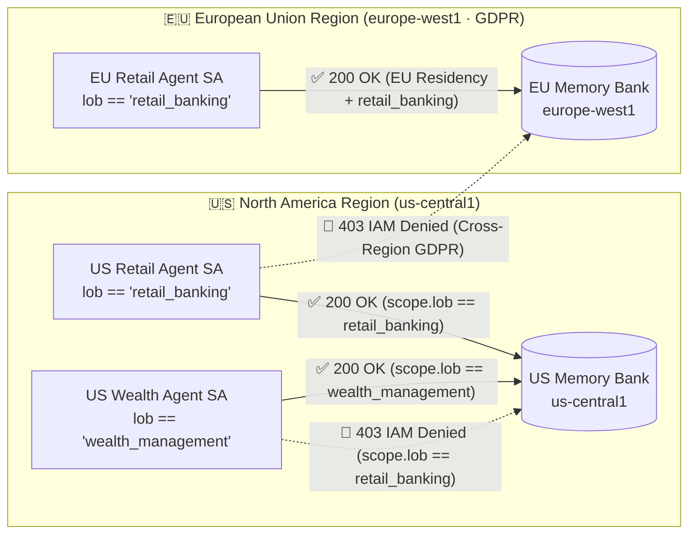

# Advent of Agents — Season 3 · Day 15: Memory Isolation & Regional Compliance (GDPR)

[](https://adventofagents.com/2026/10/15)
[](https://docs.cloud.google.com/agent-builder/agent-engine/memory-bank/overview)
[](https://registry.terraform.io/providers/hashicorp/google/latest/docs/resources/vertex_ai_reasoning_engine)

> **Question:** *"How do we prevent persistent agent memory from leaking across regional borders or lines of business?"*  
> **Pattern:** Configure **Vertex AI Agent Memory Bank** with strict runtime **namespace partitioning (`scope`)** and **regional + Line-of-Business RBAC boundaries** enforced by **Cloud IAM Conditions**.

---

## Defense-in-Depth Architecture

Persistent agent memory introduces three distinct isolation requirements in regulated enterprises:

| Layer | Threat / Failure Mode | Enforcement Mechanism | Where It Is Enforced |
| :--- | :--- | :--- | :--- |
| **1. User Isolation (Within a Tenant/LOB)** | User B (`charlie@bank.com`) or a prompt-injected LLM attempts to read User A's (`alice@bank.com`) private memories | **Composite `scope` Dictionary + ADK `ToolContext`:** Tools construct `scope={"lob": ..., "user_id": tool_context.user_id}` from server-verified session state (`tool_context` is stripped from the LLM tool schema). Memory Bank requires an **exact dictionary match** on all `scope` keys. | **Agent Runtime + Memory Bank Query Engine** |
| **2. Line-of-Business (LOB) RBAC** | A Wealth Management agent attempts to read or poison Retail Banking memories in the same Memory Bank | **Cloud IAM Condition on `aiplatform.googleapis.com/memoryScope`:** Grants `roles/aiplatform.memoryUser` only when `api.getAttribute('aiplatform.googleapis.com/memoryScope', {})['lob'] == 'retail_banking'`. | **Google Cloud IAM (`403 PERMISSION_DENIED`)** |
| **3. Regional Compliance (GDPR Data Residency)** | European customer memories (`eva@bank.eu`) leave the EU or are queried cross-border by a US agent | **Regional Memory Bank Provisioning (`europe-west1` vs. `us-central1`) + Regional IAM Condition:** Locks each principal with `resource.name.startsWith('projects/.../locations/europe-west1/reasoningEngines/...')`. | **Physical Regional Spanner Storage + Cloud IAM (`403 PERMISSION_DENIED`)** |



---

## Repository Structure

```text
.
├── agent/
│   ├── agent.py          # Multi-tenant ADK agent with ToolContext-scoped Memory Bank tools
│   ├── server.py         # FastAPI server binding verified user_id, tenant_lob & data_region
│   ├── Dockerfile        # Container image definition
│   └── requirements.txt  # Python dependencies (google-adk, google-cloud-aiplatform)
├── terraform/
│   ├── main.tf           # Provisions US & EU Memory Banks, 3 Regional/LOB SAs & IAM Conditions
│   ├── variables.tf      # Configurable project_id, us_region, eu_region, existing_us_engine_id
│   └── outputs.tf        # Exports Memory Bank resource names and Service Account emails
├── content/season3/
│   └── day15.ts          # Advent of Agents Season 3 Day 15 website content
├── deploy.sh             # Turnkey 1-command deployment script
├── demo.py               # Live 3-Act verification script (Namespace + LOB RBAC + GDPR RBAC)
└── cloudbuild.yaml       # Cloud Build CI/CD pipeline
```

---

## Quickstart (Deploy & Run the 3-Act Demo)

### 1. Authenticate with Google Cloud

```bash
gcloud auth login
gcloud auth application-default login
```

### 2. Deploy the Regional Memory Banks & Conditional IAM Boundaries

Run `./deploy.sh` targeting your project (defaults to `terraform-demo-agents`). If `terraform-demo-agent` already exists in `us-central1`, `deploy.sh` automatically reuses it for the US region and provisions the GDPR-compliant `europe-west1` Memory Bank alongside the 3 conditional IAM bindings:

```bash
chmod +x deploy.sh
./deploy.sh terraform-demo-agents
```

### 3. Run the 3-Act Live Verification Demo

Use the Python virtual environment (or any environment with `google-adk` and `google-cloud-aiplatform` installed):

```bash
python3 demo.py
```

You can also run each act individually during a live presentation:

```bash
python3 demo.py --act 1   # Act 1: Strict Namespace Partitioning (Alice vs. Charlie)
python3 demo.py --act 2   # Act 2: Line-of-Business RBAC (Wealth vs. Retail -> 403 Denied)
python3 demo.py --act 3   # Act 3: Regional GDPR Compliance (US vs. EU -> 403 Denied)
```

---

## Key Code Walkthrough

### 1. Preventing LLM Scope Spoofing with `ToolContext` (`agent/agent.py`)

In ADK, [`FunctionTool`](https://google.github.io/adk-docs/) automatically strips `tool_context: ToolContext` from the JSON schema sent to Gemini. The model can only pass `query: str` or `fact: str`—it cannot see or override `user_id`, `tenant_lob`, or `data_region`:

```python
def recall_memories(query: str, tool_context: ToolContext) -> dict:
    region, memory_bank_name, scope = _resolve_memory_context(tool_context)
    client = vertexai.Client(project=PROJECT_ID, location=region)

    retrieved = client.agent_engines.memories.retrieve(
        name=memory_bank_name,
        scope=scope,  # {"lob": verified_lob, "user_id": verified_user_id}
        similarity_search_params={"search_query": query, "top_k": 5},
    )
    return {"region": region, "scope": scope, "memories": [m.memory.fact for m in retrieved]}
```

### 2. Enforcing LOB & Regional RBAC with Cloud IAM Conditions (`terraform/main.tf`)

Vertex AI Memory Bank exposes the request's `scope` dictionary to Cloud IAM via `aiplatform.googleapis.com/memoryScope` and evaluates the canonical Reasoning Engine path on `resource.name`:

```hcl
resource "google_project_iam_member" "eu_retail_gdpr_memory_isolation" {
  project = var.project_id
  role    = "roles/aiplatform.memoryUser"
  member  = "serviceAccount:${google_service_account.eu_retail_agent.email}"

  condition {
    title       = "EU_Retail_Banking_GDPR_Memory_Isolation"
    description = "GDPR Regional Boundary: Restricts memory access to the europe-west1 Memory Bank and scope.lob == retail_banking"
    expression  = "resource.name.startsWith('projects/${local.project_number}/locations/europe-west1/reasoningEngines/${local.eu_engine_id}') && api.getAttribute('aiplatform.googleapis.com/memoryScope', {})['lob'] == 'retail_banking'"
  }
}
```

---

## References

- [Memory Bank Overview (Vertex AI Agent Engine)](https://docs.cloud.google.com/agent-builder/agent-engine/memory-bank/overview)
- [Namespace Scope & Cloud IAM Conditions for Memory Bank](https://docs.cloud.google.com/agent-builder/agent-engine/memory-bank/Quickstart-api#iam-conditions)
- [Provision Agent Runtimes & Memory Banks with Terraform](https://docs.cloud.google.com/gemini-enterprise-agent-platform/scale/runtime/use-terraform)
